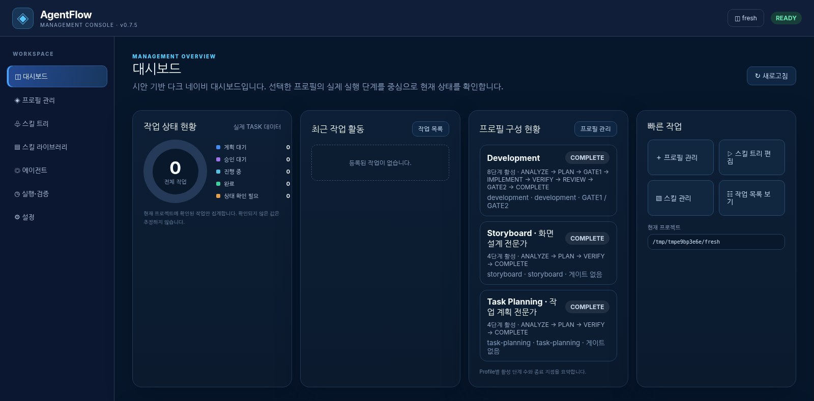

# AgentFlow

**OpenCode · Claude Code · Codex를 위한 프로젝트 로컬 AI 개발 워크플로 프레임워크**

AgentFlow는 AI 에이전트가 사용자 요청을 분석하고, 계획을 수립하며, 승인된 범위에서 구현·검증·리뷰하도록 돕는 **프로필·스킬 트리·작업 증거 관리 프레임워크**입니다. npm/npx로 프로젝트에 설치할 수 있으며, Python 기반 관리 콘솔과 프로젝트별 전문 스킬 구성을 제공합니다.

> **버전:** v1.0.1 · npm 패키지: `@gon1942/agentflow`  
> **범위:** 프로젝트별 설치·구성 관리. 실제 에이전트 실행 및 검증 통과를 자동으로 보증하는 서비스가 아닙니다.

## 관리 콘솔 미리보기




## 주요 기능

- **3개 에이전트 환경 지원:** OpenCode, Claude Code, Codex용 프로젝트 로컬 설정과 스킬 경로
- **5개 작업 프로필:** 전체 개발, 개발 Worker, 프로젝트 아키텍트, 스토리보드, 작업 계획
- **단계별 스킬 트리:** 단계와 스킬의 연결·필수/선택 설정 및 프로필별 실행 범위 관리
- **승인 중심 개발 흐름:** ANALYZE → PLAN → Gate 1 → IMPLEMENT → VERIFY → REVIEW → Gate 2 → COMPLETE
- **독립 검증과 리뷰:** Verifier와 Reviewer 역할 분리, 실제 근거 기반 결과 판정
- **프로젝트 로컬 웹 콘솔:** 프로필·스킬·작업 상태·설정 확인 및 관리
- **스킬 출처 및 무결성 관리:** 고정 원본, 설치 잠금 파일, SHA-256 검사; 설치 확인과 네이티브 로딩 검증 구분
- **안전한 업데이트:** 기존 프로젝트의 Project Architect 스킬 구성 이전 시 미리보기와 명시적 적용 지원

## 시스템 요구 사항

| 항목 | 요구 사항 |
|---|---|
| Node.js | **18 이상** 및 npm/npx |
| Python | **3.10 이상** (`python3` 또는 `python`; 필요 시 `AGENTFLOW_PYTHON` 지정) |
| 운영 환경 | 프로젝트별 로컬 설치를 지원하는 환경 (Ubuntu/Linux 사용 예시) |
| 네트워크 | 기본 설치 시 고정된 스킬·도구 원본 확보에 필요 |

스킬과 RTK·CRG 등 지원 도구는 프로젝트 내부에 설치·관리합니다. 시스템 Chrome은 공용으로 사용할 수 있습니다. 설치기의 `--skip-tools`는 테스트용이며 운영 준비 완료를 의미하지 않습니다.

## 빠른 시작

### 1. 신규 프로젝트 설치

npm Registry에 해당 버전이 게시되어 있는 경우:

```bash
npx --yes @gon1942/agentflow@1.0.1 init ./my-project
```

이미 파일이 있는 프로젝트에 설치하면 충돌 파일을 임의로 덮어쓰지 않습니다. 설치 실패 시 로그의 원인과 필요한 원본·도구를 확인하세요.

### 2. 설치 상태 점검

```bash
npx --yes @gon1942/agentflow@1.0.1 doctor ./my-project
```

`doctor`는 필요한 구성 파일 및 관리 대상 스킬의 해시를 확인합니다. 결과가 `CONFIGURED_NOT_NATIVE_VERIFIED`라면 **구성 검사가 통과한 것이지 에이전트가 스킬을 실제 호출했다는 뜻은 아닙니다.**

### 3. 로컬 관리 콘솔 실행

```bash
cd my-project
python3 agentflow_console.py start --browser
```

브라우저를 자동으로 열 수 없는 환경에서는 콘솔이 출력하는 로컬 접속 안내를 확인하세요. 콘솔 주소에 포함된 인증 정보는 외부에 공유하지 마세요.

```bash
# 프로젝트 상태
python3 agentflow_console.py status

# 실행 중인 관리 콘솔 상태
python3 agentflow_console.py console-status

# 프로젝트의 관리 콘솔 종료
python3 agentflow_console.py stop
```

## 작업 프로필

| Profile ID | 역할 |
|---|---|
| `lifecycle-dev` | 요구사항 분석부터 구현·검증·리뷰·완료까지 전체 개발 관리 (**신규 설치 기본값**) |
| `development-worker` | 승인·인계된 작업의 구현·검증·리뷰 중심 실행 |
| `project-architect` | 요구사항·시스템 아키텍처·ADR의 설계·검증·리뷰 |
| `storyboard` | 화면 목록·상태·동작·예외를 포함한 UI/UX 스토리보드 |
| `task-planning` | 요구사항과 설계를 바탕으로 AC·의존성·검증 계획이 포함된 TASK 계획 |

프로필은 각기 다른 기본 실행 단계를 갖고 있으며, 활성 TASK가 있으면 설정 변경이 제한될 수 있습니다. 기존 TASK에 고정된 프로필·스킬 트리·승인 설정은 새로운 기본값으로 소급 변경하지 않습니다.

```bash
# 프로필 목록 확인
python3 agentflow_console.py profiles

# Project Architect 계약 확인
python3 agentflow_console.py contract --profile project-architect

# 현재 활성 프로필 확인
python3 agentflow_console.py status
```

프로필을 바꾸려면 최신 `generation`을 확인한 뒤 다음처럼 실행합니다. 다음 예시의 `1`은 **예시값**입니다.

```bash
python3 agentflow_console.py activate project-architect --generation 1
```

기존 에이전트 세션에 별도의 프로필 선택이 적용돼 있다면 프로젝트 기본 프로필 변경이 그 세션에 자동 반영되지는 않을 수 있습니다.

## Project Architect 단계별 스킬

Project Architect는 아래 8종 전문 스킬을 단계별로 연결하는 구성을 제공합니다.

| 단계 | 스킬 | 용도 |
|---|---|---|
| ANALYZE | `requirements-analyst` | 요구사항 분석·명세 |
| ANALYZE | `change-impact-analyzer` *(선택)* | 기존 코드·설계 변경 영향 분석 |
| PLAN | `project-manager` | 설계 작업 계획·산출물 구성 |
| DESIGN *(내부 `IMPLEMENT`)* | `system-architect` | 시스템·컴포넌트·C4 관점 설계 |
| DESIGN | `architecture-decision-records` *(선택)* | 설계 의사결정과 ADR 작성 |
| VERIFY | `traceability-auditor` | 요구사항 ↔ 설계 산출물 추적성 검사 |
| REVIEW | `design-review` | 독립 설계 품질 검토 |
| REVIEW | `security-auditor` *(선택)* | 보안 아키텍처 검토 |

출처: [MUSUBI](https://github.com/nahisaho/MUSUBI) · [Architecture Skills](https://github.com/eralmansouri/skills) · [Everything Claude Code](https://github.com/affaan-m/ECC)

스킬 원본은 npm 설치 패키지에 직접 동봉하지 않습니다. 설치 단계에서 지정된 소스를 획득하고 무결성을 확인하여 `.opencode/skills/`, `.claude/skills/`, `.agents/skills/`에 배치합니다. 일부 원본 저장소는 라이선스 확인이 남아 있으므로 재배포에 주의하세요.

## 작업 단계와 안전 정책

```text
사용자 요청
  ↓
SESSION → ANALYZE → PLAN
  ↓
Gate 1 (해당 프로필에서 활성화된 경우 사용자 계획 승인)
  ↓
IMPLEMENT / DESIGN
  ↓
VERIFY (독립 검증) → REVIEW (독립 리뷰)
  ↓
Gate 2 (해당 프로필에서 활성화된 경우 사용자 최종 승인)
  ↓
COMPLETE
```

- 사용자 선택이 가능한 단계는 프로필 계약에 따라 설정합니다. **단계를 건너뛴 사실을 PASS 또는 승인 완료로 기록하지 않습니다.**
- 활성 Gate의 승인은 사용자만 수행합니다. 일반 개발 완료는 승인·검증·리뷰의 실제 증거가 있어야 주장할 수 있습니다.
- `VERIFY`와 `REVIEW`는 독립 역할로 처리하며, 리뷰 수정 시 필요한 재검증을 수행합니다.
- 설치된 스킬 파일의 존재·해시 일치는 실제 에이전트 네이티브 호출의 증거가 아닙니다.
- 기존 승인·TASK·설계 문서 및 사용자 설정을 임의 변경하지 않습니다. commit/push/merge/배포는 별도 승인 대상입니다.

정확한 실행 계약의 정본은 설치된 프로젝트의 `docs/workflow/`와 `.agentflow/`에 있습니다.

## CLI 명령

npm/npx CLI는 **설치와 점검용 진입점**이며 실제 AI 작업을 수행하는 워크플로 엔진은 아닙니다.

```bash
# 신규 설치
npx --yes @gon1942/agentflow@1.0.1 init ./my-project

# 원본 파일을 준비한 오프라인/제한 네트워크 설치 예시
npx --yes @gon1942/agentflow@1.0.1 init ./my-project \
  --upstream-zip /path/to/superpowers-pinned.zip \
  --architect-archive-dir /path/to/pinned-architect-zips \
  --skip-tools

# 기존 프로젝트의 Project Architect 스킬 구성 이전 미리보기
npx --yes @gon1942/agentflow@1.0.1 upgrade ./my-project

# 확인 후 명시적으로 적용
npx --yes @gon1942/agentflow@1.0.1 upgrade ./my-project --apply

# 설치 파일과 잠금 해시 검사
npx --yes @gon1942/agentflow@1.0.1 doctor ./my-project

# 도움말 / 버전
npx --yes @gon1942/agentflow@1.0.1 --help
npx --yes @gon1942/agentflow@1.0.1 --version
```

> **주의:** `upgrade`는 AgentFlow 전체 버전 교체가 아닌 **Project Architect 스킬 구성 이전 전용**입니다. 기본 동작은 미리보기이며 `--apply`에서만 변경합니다. 오프라인 예시의 `--skip-tools`는 테스트 목적입니다.

## 설치된 프로젝트 구조

```text
my-project/
├── .agentflow/           # 프로필·Skill Tree·실행 계약
├── .ai-dev/              # 배포 메타데이터·도구·잠금 파일
├── .opencode/            # OpenCode 에이전트·명령·스킬
├── .claude/              # Claude Code 설정·에이전트·스킬
├── .agents/              # Codex 등 공통 스킬 경로
├── docs/
│   ├── requirements/    # 요구사항
│   ├── architecture/    # 아키텍처·ADR
│   ├── design/          # 설계
│   ├── storyboards/     # 화면 스토리보드
│   ├── tasks/           # active / handoffs / completed
│   ├── templates/       # 작업 산출물 템플릿
│   └── workflow/        # 워크플로·승인 정책 정본
├── AGENTS.md
├── CLAUDE.md
├── opencode.json
└── agentflow_console.py
```

숨김 폴더까지 확인하려면 `tree -a -L 3 my-project`를 사용하세요.

## 기존 프로젝트 업그레이드

업그레이드 전에 전체 프로젝트를 백업하고 실행 중인 관리 콘솔·TASK 상태를 확인하세요.

```bash
# 먼저 변경 내용 확인 (쓰기 없음)
npx --yes @gon1942/agentflow@1.0.1 upgrade ./my-project

# Project Architect 스킬 이전 적용
npx --yes @gon1942/agentflow@1.0.1 upgrade ./my-project --apply

# 결과 점검
npx --yes @gon1942/agentflow@1.0.1 doctor ./my-project
```
